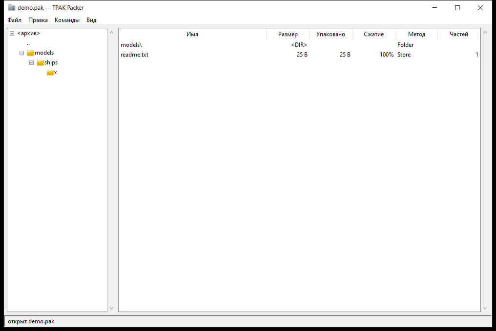

# TPAK Packer — `.pak` archiver for Star Conflict

Pack and unpack Star Conflict `.pak` archives (TPAK v7) with a two-pane GUI
and a separate, GUI-free archive handler. The format is implemented from
scratch — no third-party libraries.

**Русская версия:** [README.ru.md](README.ru.md)



## Features

| Action | How |
|---|---|
| Open archive | **File → Open** / `Ctrl+O`; a path can also be passed as an argument: `TPAK_Packer.exe game.pak` |
| Streaming open | the archive is not loaded into memory: large packs open instantly, entries are read on demand |
| Folder tree | left panel; a single click opens the folder, `..` goes one level up |
| File list | name, size, packed, ratio, method, chunk count; click a column header to sort |
| Search | **Search** box (`Ctrl+F`) across all entries |
| Extract | **Extract to…** (`Ctrl+E`) — selected entries or everything; **Extract here** unpacks next to the archive |
| Add | files or a whole folder (into the current folder of the archive) |
| Delete | `Del` |
| Rename | `F2` |
| Preview | double-click: text or hex dump (up to 256 KiB) |
| Test | read the archive chunk by chunk and compare sizes |
| Repack check | rebuild in a temporary file and compare SHA-256 of every entry |
| Create | **Create from folder…** packs a directory into a new `.pak` |
| Save | `Ctrl+S` (keeps a `.bak` copy), **Save as…** for a new file |
| Properties | format version, file count, sizes, pending changes |

Changes (add, delete, rename) are accumulated in memory and written only by
**Save**; the source archive is untouched until then.

## Archive handler

`pak_handler.py` — high-level API without GUI:

```python
from pak_handler import PakArchive

h = PakArchive().open("data/models_ships_race_1.pak")
for e in h.entries():
    print(e["name"], e["size"])

h.extract(["models\\ships\\race_1\\r1_s_t1.mdl-hdr"], "out")
h.add_file("new.txt")
h.save()          # writes a .bak next to the original
h.test()          # list of problems (empty = the archive reads fine)
```

Methods: `open/new/close`, `entries`, `folders`, `read`, `extract`,
`add_bytes/add_file/add_dir`, `delete`, `rename`, `save`, `create_from_dir`,
`test`, `verify_repack`. Unsafe entry names (`..`, absolute paths) are skipped
during extraction.

## Running from source

```bash
python pak_gui.py                 # empty window
python pak_gui.py game/data.pak   # open an archive immediately
```

The interface language is detected from the OS: Russian for a Russian Windows UI, English otherwise (`PAKER_LANG=ru|en` overrides).

Requires Python 3.9+ with tkinter (included in the standard Windows installer).
No third-party runtime dependencies.

## Build from source

### Prerequisites

* Windows 10/11;
* **Python 3.9+** from python.org (the standard installer includes tkinter);
* no runtime dependencies for the app itself.

Check the interpreter:

```bash
python --version
python -c "import tkinter; print(tkinter.TkVersion)"
```

### Run without building

```bash
git clone <repo-url> paker
cd paker
python pak_gui.py                 # empty window
python pak_gui.py path/to/game.pak
```

### Build the executable

One-time dependency:

```bash
python -m pip install --upgrade pyinstaller
```

Then either the helper script:

```powershell
powershell -ExecutionPolicy Bypass -File build.ps1
```

or manually:

```powershell
python -m PyInstaller --noconfirm --clean --onefile --windowed `
  --name TPAK_Packer --icon icons\tpak.ico `
  --add-data "icons;icons" pak_gui.py
```

Result: **`dist\TPAK_Packer.exe`** — a single windowed executable with the
application icon and bundled `icons/` resources (the app falls back to plain
text buttons if the folder is missing).

`build.ps1` does the same: upgrades PyInstaller, passes `icons/` into the
executable and prints the output path.

### Tests before building

```bash
python -m unittest discover -s tests -v
```

Seven tests cover the archive handler (create, list, read, extract, add,
delete, rename, save, integrity test, repack verification, zip-slip protection)
and a GUI smoke test that opens an archive and lists its entries.

### Clean rebuild

```bash
rmdir /s /q build dist
```

PyInstaller regenerates `TPAK_Packer.spec` on every build; it is not required in
the repository. If Defender or an antivirus quarantines a fresh one-file build,
add `dist\` to exclusions or build with `--onedir` instead of `--onefile`.

## Format notes

TPAK v7: header, file table, chunk table, packed data (deflate/store), names in
an encrypted table. TFD texture chunks are split by mip levels the same way the
game does it. Written archives are game-compatible — the game reads loose files
from `data/` on top of the paks.

## Tests

```bash
python -m unittest discover -s tests -v
```

## License

MIT — see [LICENSE](LICENSE).

This is an unofficial community tool, not affiliated with Targem Games or the
Star Conflict developers. Game assets are not distributed with this project.
